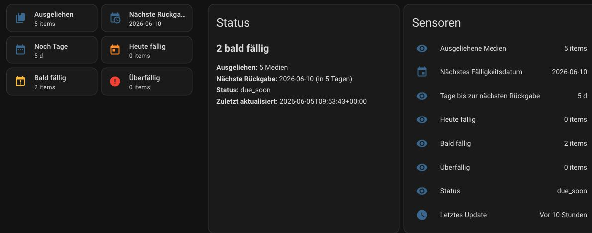
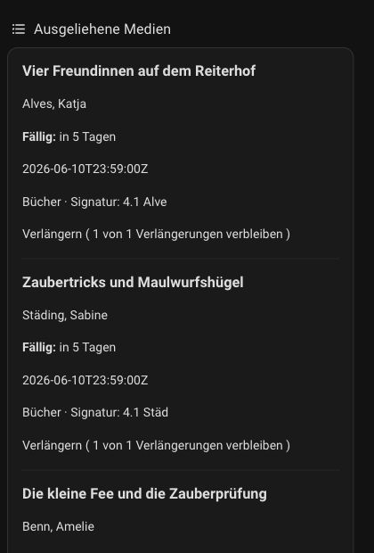

# ShelfWatch


[Deutsch](README.md) | **English**

ShelfWatch is a Home Assistant custom integration for Koha / LMSCloud library
accounts. It logs in to the OPAC account page, reads current checkouts from the
HTML account view, and exposes due dates, counts, status, and checkout details
as Home Assistant sensors.

The minimum supported Home Assistant version is `2026.1.2`.

## Features

- UI setup through Home Assistant config flow
- one Home Assistant config entry per library account
- multiple people or library cards
- Koha / LMSCloud OPAC HTML login and scraping
- current checkout count
- next due date and days remaining
- due today, due soon, and overdue counts
- full borrowed-media list in sensor attributes
- configurable due-soon window and update interval
- optional native Home Assistant Todo list for reading progress
- optional completed and remaining media sensors
- German and English Home Assistant translations
- reauthentication when stored credentials are rejected

## Dashboard Example

ShelfWatch works with built-in Home Assistant cards and does not require a
custom Lovelace card.



The checkout list can be rendered with a Markdown card using the `books`
attribute of the account's books sensor:



1. Edit the dashboard and add a Markdown card.
2. Find the ShelfWatch books sensor on the integration's device page.
3. Use `state_attr('sensor.my_account_books', 'books')` in the card template.
4. Loop over fields such as `title`, `author`, `due_in_days`, `media_type`,
   `call_no`, and `renewal_info`.

The complete ready-to-use template is available in the
[German README](README.md#ausgeliehene-medien-als-liste).

## Installation with HACS

[](https://my.home-assistant.io/redirect/hacs_repository/?owner=twuertele&repository=ShelfWatch&category=integration)

Until ShelfWatch is available as a default HACS repository:

1. Open HACS.
2. Open the three-dot menu.
3. Choose **Custom repositories**.
4. Add `https://github.com/twuertele/ShelfWatch`.
5. Select category **Integration**.
6. Download **ShelfWatch**.
7. Restart Home Assistant.

## Setup

After restarting Home Assistant:

1. Go to **Settings** -> **Devices & services**.
2. Select **Add integration**.
3. Search for **ShelfWatch**.
4. Enter an account name, OPAC base URL, user ID, and password.
5. Submit the form.

The account name is a free display name for the person or library card, for
example a child's name.

Example OPAC base URL:

```text
https://sb-muehlacker.lmscloud.net
```

ShelfWatch validates the login before creating the config entry.

## Sensors and options

ShelfWatch creates sensors for checkouts, the next due date, remaining days,
overdue items, items due today, items due soon, status, the full media list,
and the last update.

Account options configure the due-soon threshold, update interval, and the
optional reading-progress Todo list. Returned media can be completed
automatically and retained as reading history.

## Why HTML scraping?

ShelfWatch intentionally uses the library account login and HTML page instead
of the Koha REST API.

For the tested LMSCloud OPAC, the REST API is not suitable for simple end-user
authentication. Basic auth is disabled, and the required checkout data is not
loaded through public browser-side API calls.

The login flow first loads the OPAC form, preserves its hidden fields such as
the CSRF token, and then submits the field names provided by that form. Koha
and LMSCloud installations can differ by version, city, operator, or custom
theme, so another OPAC may require a small compatibility adjustment.

## Privacy

Credentials are stored in the Home Assistant config entry. ShelfWatch does not
send credentials or checkout data to a third-party service. Data is fetched
directly from the configured OPAC.

## Current limitations

- Renewal actions are not implemented yet.
- Parsing depends on the Koha / LMSCloud OPAC HTML structure.
- Custom themes or account pages may require parser adjustments.
- Detailed media lists are currently primarily available through entity
  attributes and dashboards.

## Support

Report problems and suggestions through
[GitHub Issues](https://github.com/twuertele/ShelfWatch/issues). Include the
Home Assistant version, ShelfWatch version, and Koha / LMSCloud OPAC in use,
but never include credentials.
